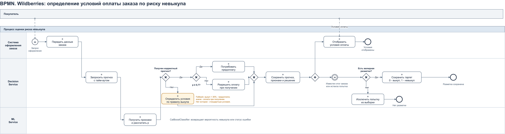
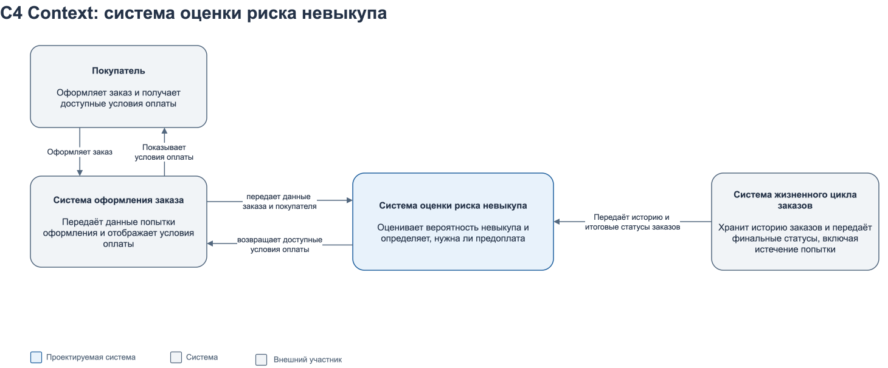
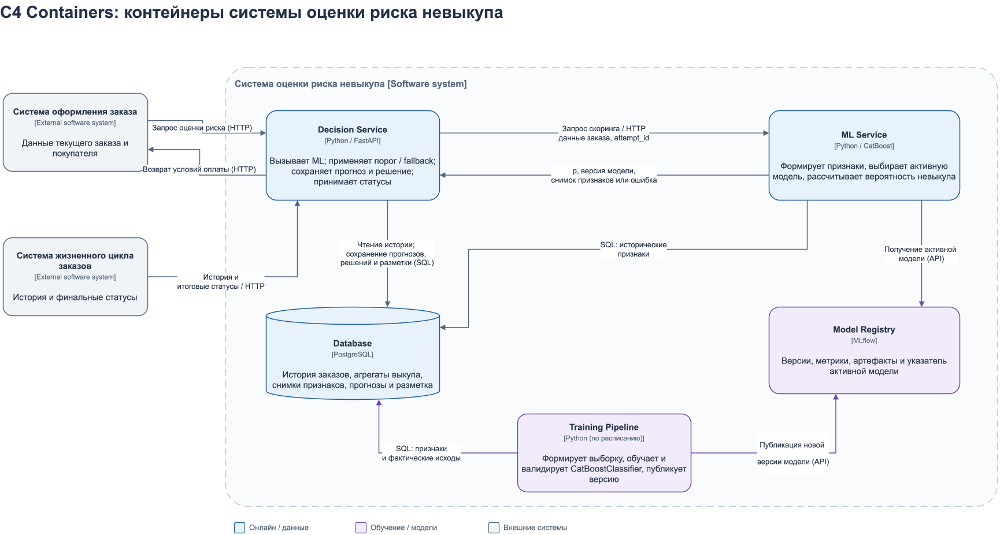
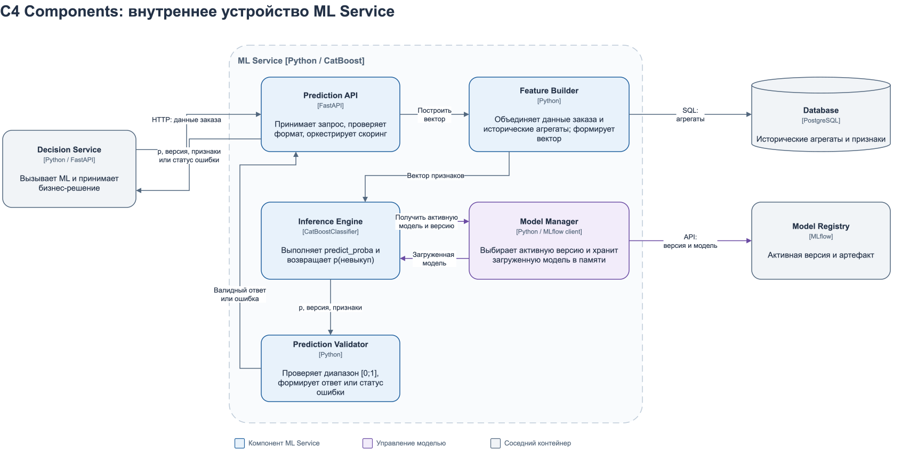

# Wildberries: прогноз вероятности невыкупа заказа

## 1. Компания и бизнес-процесс

Если покупатель Wildberries не забирает заказ или отказывается от него в ПВЗ, компания несёт дополнительные расходы на хранение и доставку.

Идея проекта - использовать ML для оценки риска невыкупа заказа. Если риск высокий, система требует предоплату.

Цель - снизить количество невыкупленных заказов и расходы на обратную логистику.

## 2. Границы процесса

Процесс начинается при оформлении заказа и заканчивается показом условий оплаты покупателю. Позже итоговый статус заказа используется для обучения модели.

Смежные бизнес-процессы (оплата, доставка, работа ПВЗ, и тд) не рассматриваются. Для простоты считаем, что в заказе один товар.

## 3. ML-задача

Бинарная классификация. Используем CatBoostClassifier, так как данные табличные.

Признаки:

- Покупатель: процент выкупа, количество заказов и отказов.
- Товар: категория, цена, рейтинг, процент выкупа.
- Заказ: скидка, срок доставки.
- Календарь: день недели, месяц.

Все признаки известны на момент оформления заказа.

Таргет:

- 0 - товар выкуплен;
- 1 - покупатель отказался от товара или не забрал его в срок.

Технические отмены, отказы из-за брака, возвраты после выкупа и незавершённые заказы не учитываем.

Модель возвращает вероятность невыкупа в Decision Service. Метрики качества - LogLoss и ROC-AUC.

## 4. BPMN

### Основной сценарий

1. Система оформления заказа передаёт данные в Decision Service.
2. Decision Service запрашивает прогноз у ML Service.
3. ML Service собирает признаки и рассчитывает вероятность невыкупа.
4. Decision Service определяет условия оплаты.
5. Прогноз, признаки, версия модели и решение сохраняются в БД. Покупатель видит условия оплаты.

### Fallback

Если модель недоступна, не ответила вовремя или вернула некорректный результат, используем процент выкупа покупателя.

| Условие | Решение |
| --- | --- |
| Вероятность невыкупа >= 70% | Предоплата |
| Вероятность невыкупа < 70% | Оплата при получении доступна |
| Fallback: процент выкупа < 30% | Предоплата |
| Fallback: процент выкупа >= 30% | Оплата при получении доступна |
| Fallback: нет истории | Стандартные условия оплаты |

При ошибке вместо прогноза сохраняем статус ошибки, правило и решение.

### Обратная связь

Когда становится известен итог заказа, Decision Service связывает его с прогнозом по `attempt_id` и сохраняет таргет в БД. Если подходящей разметки нет, запись не используется для обучения.

Модель периодически переобучается на накопленных данных. После валидации новая версия сохраняется в реестре моделей.

Предоплата может влиять на поведение покупателя, поэтому условия оплаты тоже сохраняются. Если покупатель не оформил заказ, это не считается невыкупом. Влияние предоплаты на невыкуп и конверсию можно проверить отдельным экспериментом.

## 5. C4

### Context

Система оформления заказа запрашивает оценку риска и получает условия оплаты. Система жизненного цикла заказов передаёт историю и итоговые статусы.

### Containers

| Контейнер | Технология | Назначение |
| --- | --- | --- |
| Decision Service | Python / FastAPI | Определяет условия оплаты и обрабатывает обратную связь |
| ML Service | Python / CatBoost | Собирает признаки и рассчитывает прогноз |
| Database | PostgreSQL | Хранит историю, признаки, прогнозы, решения и разметку |
| Training Pipeline | Python | Обучает и валидирует модель |
| Model Registry | MLflow | Хранит версии, метрики и артефакты моделей |

Сервисы взаимодействуют по HTTP, с БД - через SQL, с реестром - через API MLflow.

### Components

Внутри ML Service:

| Компонент | Назначение |
| --- | --- |
| Prediction API | Принимает запрос и возвращает ответ |
| Feature Builder | Собирает признаки |
| Model Manager | Выбирает и загружает активную версию модели |
| Inference Engine | Рассчитывает вероятность невыкупа |
| Prediction Validator | Проверяет результат |

ML Service только возвращает прогноз. Решение об оплате принимает Decision Service.

## 6. Файлы

- `schemas.drawio` - все четыре схемы. Открывается в [diagrams.net](https://app.diagrams.net/).
- `.svg` - изображения схем.
